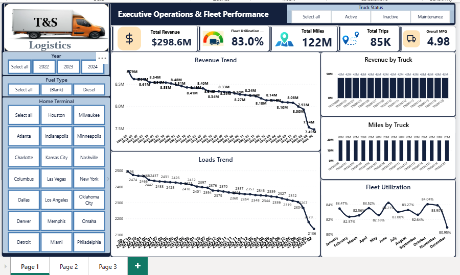
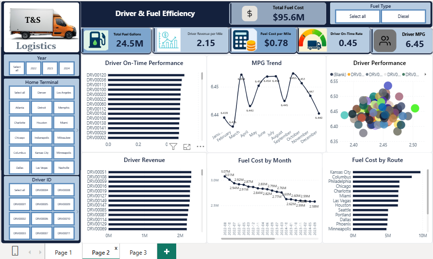
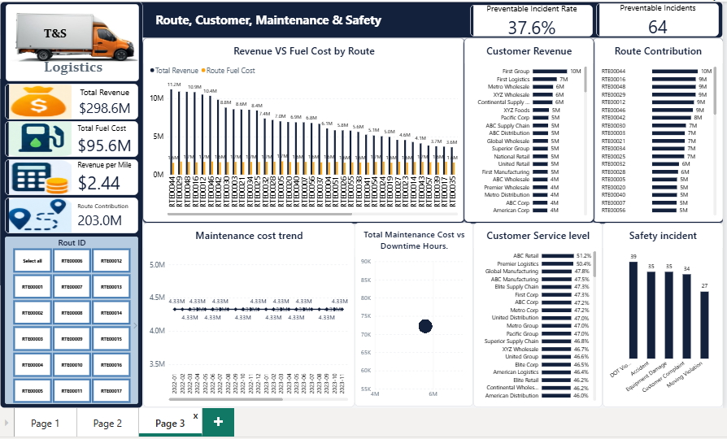

# Logistics Operations & Business Performance Analytics

### A Power BI Business Intelligence Capstone Project | TS Academy

This project explores logistics operations and business performance through interactive Power BI dashboards. It analyzes driver performance, fleet utilization, route contribution, fuel efficiency, customer service, maintenance costs, downtime, and safety performance to support data-driven operational decision-making.

---

## Project Overview

This project was completed as a Data Analytics Capstone Project at TS Academy.

The analysis focuses on transforming logistics operational data into meaningful business insights. Using Microsoft Excel and Power BI, multiple related datasets were prepared, modeled, and analyzed to develop an interactive reporting solution.

The final solution consists of three dashboards designed to provide management with visibility into operational performance, asset efficiency, financial contribution, and areas requiring improvement.

## Business Problem

Logistics businesses generate large volumes of data across drivers, vehicles, routes, trips, loads, fuel purchases, maintenance activities, customers, deliveries, and safety incidents.

Without a consolidated analytical view, it can be difficult to:

- Monitor driver performance and delivery reliability.
- Understand revenue and fuel-related costs across routes.
- Evaluate fleet utilization and asset productivity.
- Identify fuel efficiency and consumption patterns.
- Monitor maintenance expenditure and vehicle downtime.
- Assess customer revenue and delivery service levels.
- Track safety incidents and preventable occurrences.

This project addresses these challenges through an integrated Power BI reporting solution.

## Project Objectives

The main objectives were to:

1. Evaluate driver performance and on-time delivery rates.
2. Analyze route revenue and fuel-related costs.
3. Measure fleet utilization and revenue per asset.
4. Examine fuel efficiency and fuel expenditure.
5. Analyze vehicle maintenance costs and downtime.
6. Evaluate customer revenue and service performance.
7. Monitor safety incidents and preventable incidents.
8. Develop interactive dashboards to support business decisions.

## Tools & Technologies

- **Microsoft Excel:** Data preparation and initial data handling.
- **Microsoft Power BI:** Data modeling, visualization, and dashboard development.
- **DAX:** Creation of calculated measures and business performance indicators.

## Dataset Overview

The project uses a multi-table logistics operations dataset comprising 14 related tables:

1. Drivers
2. Trucks
3. Trailers
4. Customers
5. Facilities
6. Routes
7. Loads
8. Trips
9. Fuel Purchases
10. Maintenance Records
11. Delivery Events
12. Safety Incidents
13. Driver Monthly Metrics
14. Truck Utilization Metrics

The tables were connected through relevant identifiers and relationships to support integrated analysis.

The original dataset is not included in this repository due to data redistribution considerations.

## Data Preparation & Modeling

The analytical workflow involved:

- Reviewing the available operational datasets.
- Preparing and organizing the data in Excel.
- Importing the datasets into Power BI.
- Establishing relationships between related tables.
- Developing a structured data model.
- Creating a dedicated Date table for time-based analysis.
- Developing DAX measures for key performance indicators.
- Validating measures and calculations before dashboard development.

## Key Performance Indicators

The project evaluates several operational and business KPIs, including:

- Total Revenue
- Total Loads
- Total Trips
- Total Miles
- Fleet Utilization Rate
- Overall Miles Per Gallon (MPG)
- Driver On-Time Delivery Rate
- Driver MPG
- Driver Revenue per Mile
- Total Fuel Cost
- Fuel Cost per Mile
- Route Contribution after Fuel Cost
- Total Maintenance Cost
- Maintenance Cost per Mile
- Total Downtime Hours
- Customer Revenue
- Total Safety Incidents
- Preventable Incidents
- Preventable Incident Rate

---

# Dashboard Development

## 1. Executive Operations & Fleet Performance

This dashboard provides a high-level overview of logistics operations and fleet performance.

### Key areas analyzed

- Overall revenue performance.
- Load and trip volumes.
- Total operational mileage.
- Fleet utilization.
- Overall fuel efficiency.
- Revenue performance by truck.
- Mileage distribution across fleet assets.
- Operational trends over time.

### Business purpose

To provide management with a consolidated view of business activity, fleet productivity, and overall operational performance.

---

## 2. Driver Performance & Fuel Efficiency

This dashboard focuses on driver productivity, delivery reliability, and fuel efficiency.

### Key areas analyzed

- Driver on-time delivery rates.
- Driver miles per gallon.
- Revenue per mile by driver.
- Revenue contribution by driver.
- Monthly fuel expenditure.
- Fuel efficiency trends.
- Fuel cost across routes.
- Relationships between driver productivity and fuel efficiency.

### Business purpose

To identify differences in driver performance, monitor fuel efficiency, and support targeted improvements in driver productivity and operational cost management.

---

## 3. Route, Customer, Maintenance & Safety Analytics

This dashboard provides deeper analysis of route contribution, customer performance, vehicle maintenance, downtime, and safety.

### Key areas analyzed

- Route revenue compared with fuel costs.
- Route contribution after fuel cost.
- Revenue by customer.
- Customer delivery service levels.
- Maintenance expenditure trends.
- Maintenance cost versus vehicle downtime.
- Safety incidents by type.
- Preventable incidents and their rate.

### Business purpose

To support route performance evaluation, customer management, preventive maintenance planning, and improved safety monitoring.

---

## Key Analytical Insights

The dashboards provide visibility into several important operational relationships:

### Driver Performance
Driver-level analysis supports comparison of on-time delivery, fuel efficiency, and revenue per mile, helping management identify performance gaps and opportunities for improvement.

### Fleet Utilization
Truck-level mileage, revenue, and utilization metrics provide insight into how effectively fleet assets are being deployed.

### Fuel Efficiency
Fuel expenditure, MPG, and fuel cost per mile provide indicators for identifying inefficient fuel consumption and opportunities for cost control.

### Route Contribution
Comparing route revenue with fuel costs helps identify differences in route-level financial contribution. This measure represents contribution after fuel cost and should not be interpreted as full net profit.

### Maintenance & Downtime
Analyzing maintenance expenditure alongside downtime hours helps identify vehicles that may require closer monitoring, preventive maintenance, or further operational evaluation.

### Customer Performance
Customer revenue and delivery service metrics provide a basis for evaluating customer value and service consistency.

### Safety Performance
Safety incident and preventable incident analysis supports safety monitoring and helps identify areas where additional preventive controls may be required.

## Business Recommendations

Based on the analytical framework, the following actions are recommended:

1. Introduce regular driver performance reviews using on-time delivery, MPG, and revenue-per-mile indicators.
2. Monitor underutilized vehicles and improve fleet allocation.
3. Investigate routes with comparatively high fuel costs or weak contribution after fuel cost.
4. Strengthen preventive maintenance for vehicles associated with high maintenance expenditure and downtime.
5. Monitor customer service levels alongside customer revenue to support customer retention.
6. Use safety incident patterns to guide driver training and preventive safety measures.
7. Establish routine KPI monitoring through the Power BI dashboards to support continuous operational improvement.

## Business Value

The reporting solution provides a consolidated analytical view of logistics operations and can support management decisions relating to:

- Fleet and asset utilization.
- Driver performance management.
- Fuel cost monitoring.
- Route performance evaluation.
- Maintenance planning.
- Customer service improvement.
- Safety performance monitoring.

## Skills Demonstrated

- Data preparation and cleaning
- Data modeling and relationship management
- DAX measures and KPI development
- Business intelligence
- Power BI dashboard development
- Data visualization
- Logistics and operational analytics
- Fleet performance analysis
- Business insight generation
- Analytical recommendations

## Project Information

**Project:** Logistics Operations & Business Performance Analytics

**Project Type:** Data Analytics Capstone Project

**Institution:** TS Academy

**Status:** Completed

**Primary Tool:** Microsoft Power BI

---

## Repository Contents

- `dashboards/` – Three Power BI dashboard screenshots.
- `powerbi/` – Power BI project file, where available.
- `documentation/` – Supporting insights and recommendations report, where available.
- `data/` – Dataset information and documentation.

---

## Conclusion

This project demonstrates how business intelligence and data analytics can transform operational datasets into structured reporting solutions. By integrating fleet, driver, route, fuel, maintenance, customer, and safety metrics, the dashboards provide a foundation for improved visibility, performance monitoring, and data-driven logistics management.

**Developed as part of the TS Academy Data Analytics Capstone Project.**
